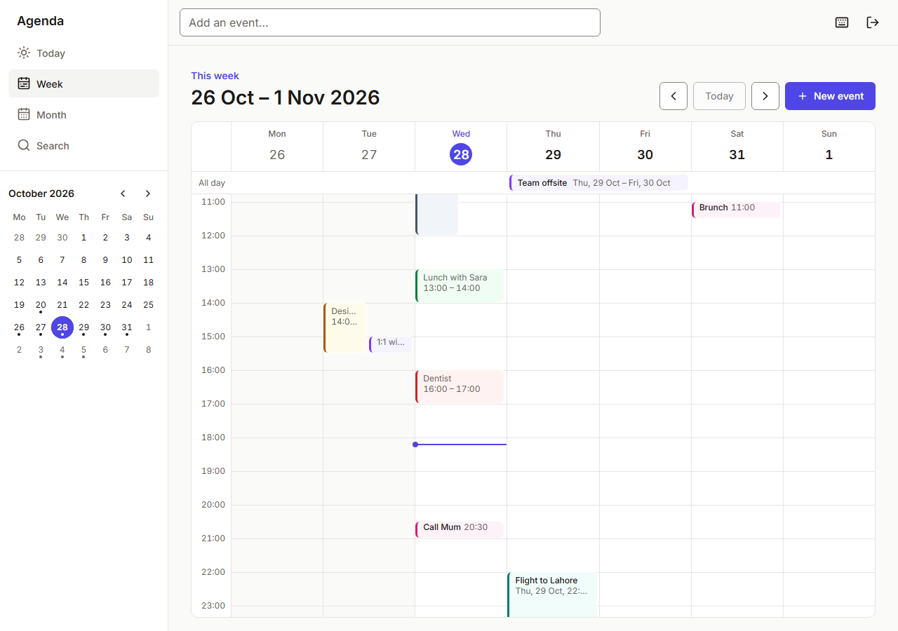
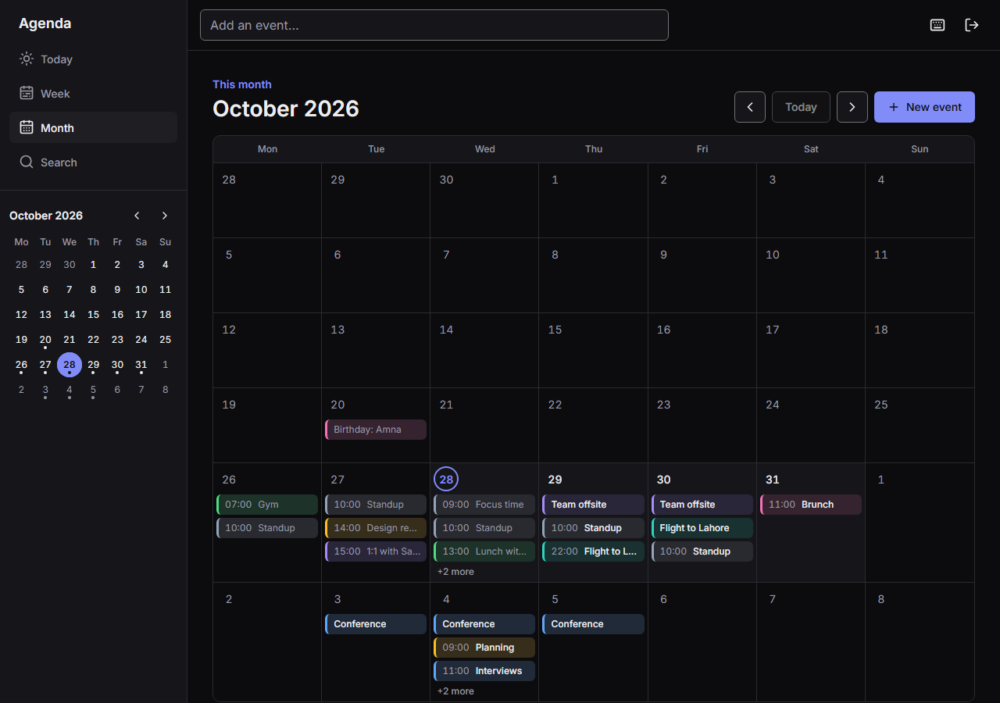
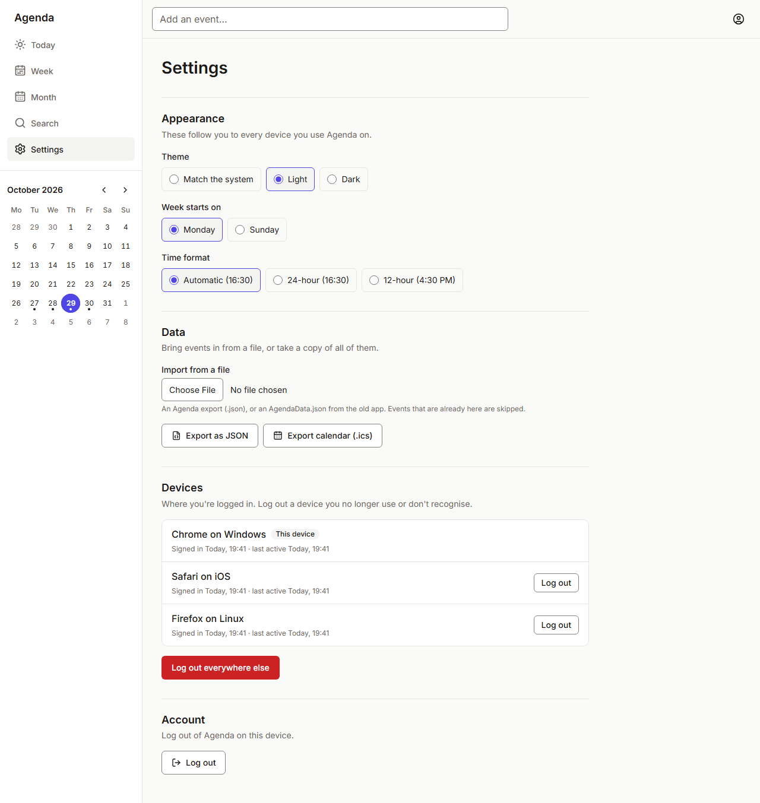
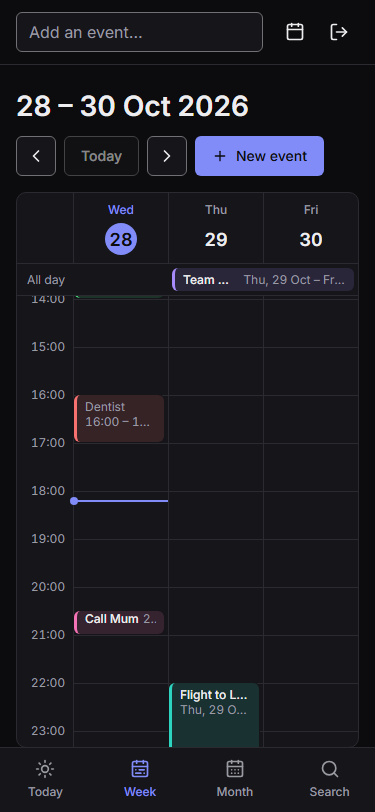

# Agenda

[](https://github.com/xitas/agenda/actions/workflows/ci.yml)

Agenda is a personal agenda and calendar. It started as a small teaching project (a Create React App frontend with an Express + SQLite API) and is being rebuilt as a TypeScript monorepo that ships as:

- a **web** app you can install (Vite + React, a PWA): **done**
- an **API** (Hono + Drizzle + SQLite): **done**
- a **desktop** app (Tauri): next
- a **Chrome extension** (Manifest V3) and a **mobile** app (Expo): later

See [docs/PLAN.md](docs/PLAN.md) for the phases.

## Features (web)

- **Today, Week and Month views.** The Week view lays overlapping events side by side, spans multi-day events across the all-day strip, and shows 3 days with swipe on phones.
- **QuickAdd.** Type "Dentist tomorrow 4pm #red" and see what it will create before you press Enter.
- **Event editor.** Typed or picked dates, typed times on your clock, colors, reminders, location and notes. Saves are optimistic and roll back if the server says no.
- **Search** across every event's title, location and notes.
- **Delete with Undo,** everywhere.
- **Keyboard shortcuts:** N, T, D/W/M, ←/→, `/`, E, Delete and `?`.
- **Settings shared by all your devices:** theme, week start (Monday or Sunday), and 12- or 24-hour time.
- **Import and export.** Import an old `AgendaData.json` or an Agenda export, with a report of anything skipped and why. Export as JSON or `.ics`.
- **Devices.** See where you're logged in, and log out other devices.
- **Installable** from Chrome, with an app shell that loads from a service worker. The API is never cached, so your data is always current.
- **Light and dark themes,** WCAG AA contrast (checked by tests), keyboard focus everywhere, and axe checks in the test suite.

## Screenshots

| Week                                    | Month (dark)                                         |
| --------------------------------------- | ---------------------------------------------------- |
|  |  |

| Settings                                   | Week on a phone (dark)                                         |
| ------------------------------------------ | -------------------------------------------------------------- |
|  |  |

## Workspace layout

```
apps/
  api/        Hono API: events, auth (cookie or token), settings, import/export
  web/        Vite + React app (PWA)
  e2e/        Playwright smoke test against the built api + web
packages/
  core/       Shared types, validation, dates, layout, quick add and the API client
  tokens/     Design tokens (color, spacing, type) for every platform
  ui/         Shared React components for web-based apps
  config/     Shared tsconfig, ESLint, Prettier and Vitest settings
```

Apps depend on packages through `workspace:*` links, so a change in `packages/core` is picked up by `apps/web` without publishing anything. Library packages compile to `dist/` with type declarations.

## Requirements

- Node.js 22.12 or newer (`.nvmrc` pins 24)
- pnpm, through Corepack: run `corepack enable` once (from an administrator terminal on Windows). The exact pnpm version (12.x) comes from `packageManager` in `package.json`.
- Git checks files out with LF line endings on every OS (`.gitattributes`), so Prettier gives the same result everywhere.

## Getting started

The first time, give the API a password (it refuses to start without one):

```sh
pnpm i
cp apps/api/.env.example apps/api/.env
pnpm -s --filter @agenda/api hash-password >> apps/api/.env   # asks for the password twice
```

Then:

```sh
pnpm dev
```

`pnpm dev` builds the shared packages, then starts the API (http://localhost:4001) and the web app (http://localhost:5173) in watch mode. Open the web app and log in. In dev, Vite forwards `/api` to the API, so both are on one origin and the session cookie works without CORS. To run a single app:

```sh
pnpm dev --filter @agenda/web   # Vite dev server on http://localhost:5173
pnpm dev --filter @agenda/api   # API in watch mode (tsx)
```

The service worker only runs in a build. To try the installable app locally, run `pnpm build`, start the API, then `pnpm --filter @agenda/web preview` (http://localhost:4173), and use Chrome's "Install app".

## Scripts

All scripts run through [Turborepo](https://turborepo.com), which orders tasks by package dependencies and caches results.

| Command          | What it does                                                     |
| ---------------- | ---------------------------------------------------------------- |
| `pnpm dev`       | Start all apps in watch mode                                     |
| `pnpm build`     | Build every package and app (`dist/`)                            |
| `pnpm lint`      | ESLint across the workspace                                      |
| `pnpm typecheck` | `tsc --noEmit` in every package                                  |
| `pnpm test`      | Vitest in every package (with coverage gates)                    |
| `pnpm e2e`       | Playwright smoke test on the built apps (run `pnpm build` first) |
| `pnpm format`    | Format the repo with Prettier (`format:check` to verify)         |

Add `--filter @agenda/<name>` (for example `--filter @agenda/core`) to any of them to limit the run to one package and its dependencies. `pnpm --filter @agenda/web icons` regenerates the app icons from `apps/web/public/icon.svg`.

## Continuous integration

Every pull request and push to `master` runs `.github/workflows/ci.yml`. One job installs with a frozen lockfile, then runs `format:check`, `lint`, `typecheck`, `test` and `build`. A second job builds the apps and runs the Playwright smoke test in Chromium. Run the same checks locally before opening a PR.

## The original app

The v0 app (Create React App and Express) is no longer in the tree. The last commit before the rebuild is tagged `legacy-agenda`; check it out to see or run the old code. Its exports still import: Settings > Data takes an old `AgendaData.json`.
