# Agenda

[](https://github.com/xitas/agenda/actions/workflows/ci.yml)

Agenda is a personal agenda and calendar. It started as a small teaching project (a Create React App frontend with an Express + SQLite API) and is being rebuilt as a TypeScript monorepo that ships as:

- a **web** app you can install (Vite + React, a PWA): **done**
- an **API** (Hono + Drizzle + SQLite): **done**
- a **desktop** app for Windows (Tauri): **done**, talking to the API on your PC until there is a server
- a **Chrome extension** (Manifest V3, WXT): **done**
- a **mobile** app for Android (Expo): **done**, built locally

See [docs/PLAN.md](docs/PLAN.md) for the phases.

## Features (web)

- **Today, Week and Month views.** The Week view lays overlapping events side by side, spans multi-day events across the all-day strip, and shows 3 days with swipe on phones.
- **QuickAdd.** Type "Dentist tomorrow 4pm #red" and see what it will create before you press Enter.
- **Event editor.** Typed or picked dates, typed times on your clock, colors, reminders, location and notes. Saves are optimistic and roll back if the server says no.
- **Search** across every event's title, location and notes.
- **Delete with Undo,** everywhere.
- **Keyboard shortcuts:** N, T, D/W/M, ←/→, `/`, E, Delete and `?`.
- **Settings shared by all your devices:** theme, week start (Monday or Sunday), and 12- or 24-hour time.
- **Import and export.** Import an old `AgendaData.json` or an Agenda export, with a report of anything skipped and why. Export as JSON or `.ics`.
- **Devices.** See where you're logged in, and log out other devices.
- **Installable** from Chrome, with an app shell that loads from a service worker. The API is never cached, so your data is always current.
- **Light and dark themes,** WCAG AA contrast (checked by tests), keyboard focus everywhere, and axe checks in the test suite.

## Features (desktop)

- **The whole app in its own window,** logged in with a token kept in Windows Credential Manager.
- **Quick add from anywhere:** Ctrl+Shift+Space (changeable) opens a small QuickAdd window over whatever you are doing.
- **Tray menu** with your next 5 events today and tomorrow. Closing the window keeps Agenda in the tray.
- **Reminder notifications** from each event's reminders, never twice, even after a restart.
- **Launch at login,** and a **Server URL** setting for when the API runs somewhere else.

## Features (Chrome extension)

- **Popup:** today at a glance and QuickAdd with its preview, one click from any tab.
- **Add to Agenda:** highlight "Call Ali Friday 3pm" on any page, right-click, check the preview, Add.
- **Side panel** with this week, and a **toolbar badge** with what's still to come today.
- **Reminders in Chrome** if you want them (off by default, so the desktop app's aren't doubled).
- Asks only for what it uses: no content scripts, and access to your server only.

## Features (Android)

- **Today, Calendar and Search** in bottom tabs, with QuickAdd and its preview on Today.
- **Editor in a bottom sheet,** with the same rules and messages as the web.
- **Swipe left to delete,** with Undo.
- **Reminders that fire with the app closed,** on time even while the phone sleeps.
- **A Server URL setting** for the API on your PC (see [apps/mobile/README.md](apps/mobile/README.md)); plain HTTP only to local addresses.

## Screenshots

| Week                                    | Month (dark)                                         |
| --------------------------------------- | ---------------------------------------------------- |
| 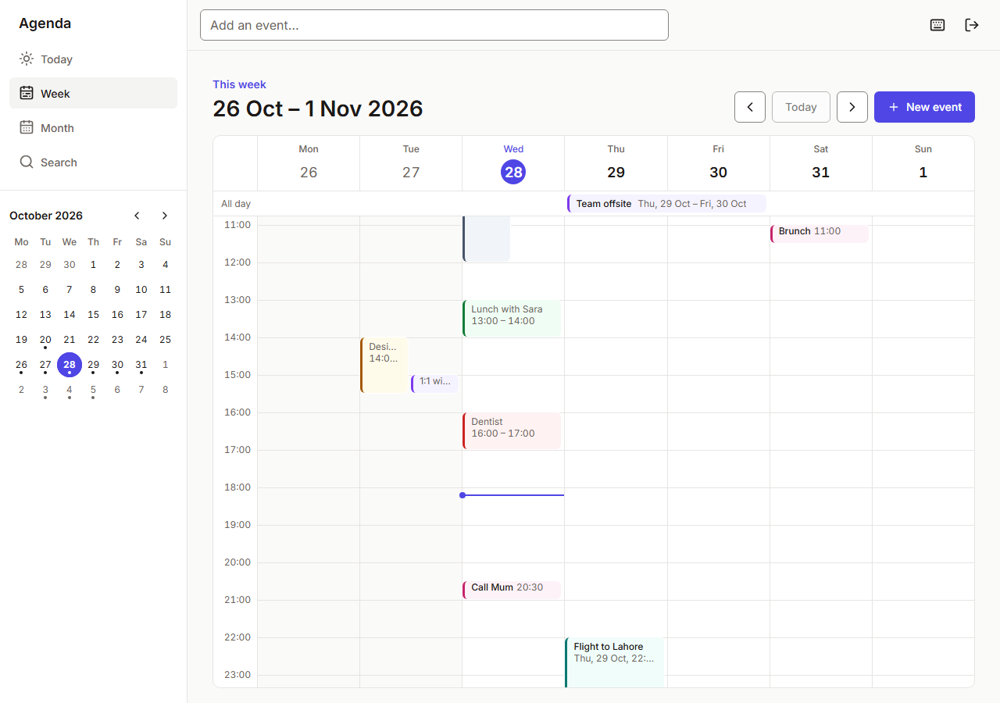 | 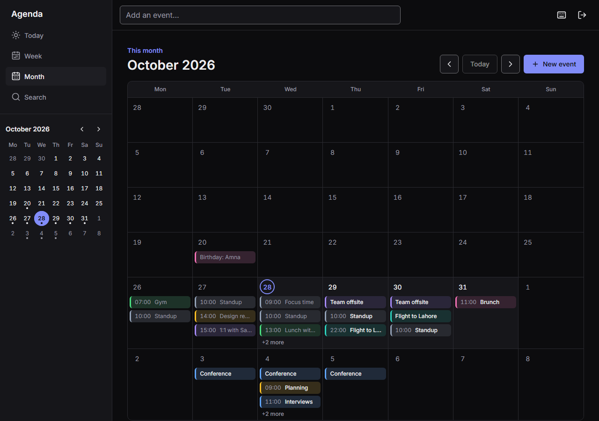 |

| Settings                                   | Week on a phone (dark)                                         |
| ------------------------------------------ | -------------------------------------------------------------- |
| 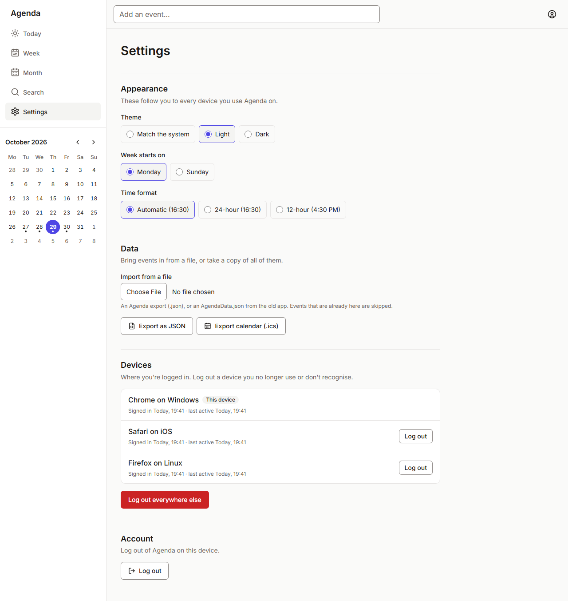 | 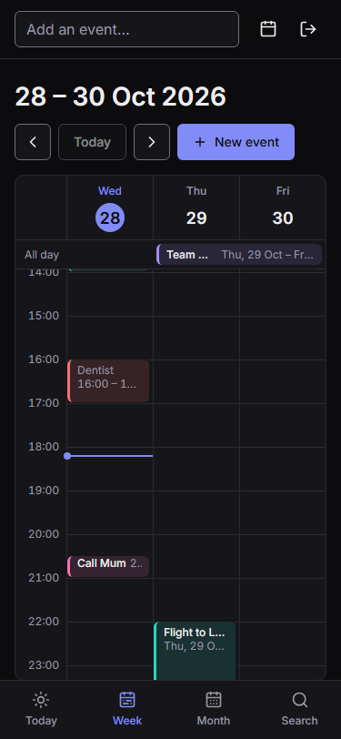 |

### Desktop

| Desktop window                                               | Desktop window (dark)                                                   |
| ------------------------------------------------------------ | ----------------------------------------------------------------------- |
| 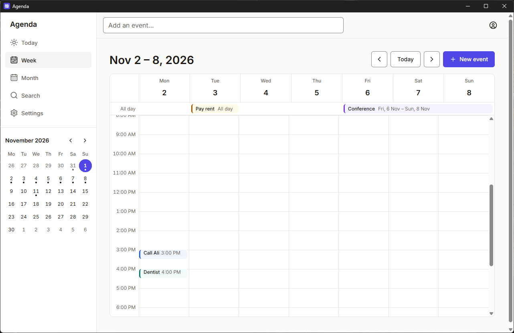 | 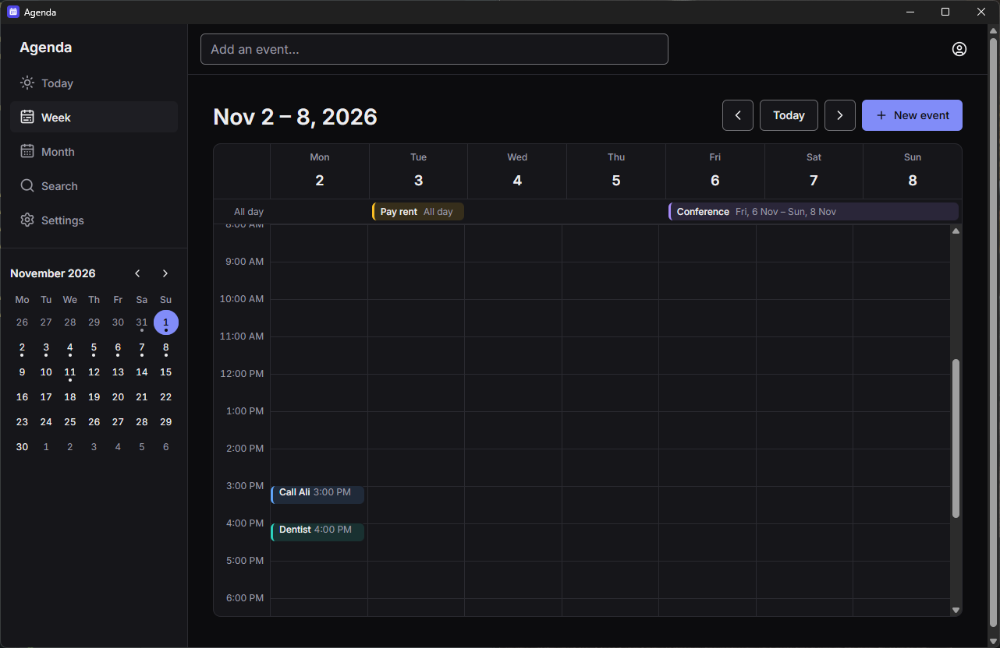 |

| Quick add from anywhere (Ctrl+Shift+Space)                                   | Tray menu                                       | Reminder                                                            |
| ---------------------------------------------------------------------------- | ----------------------------------------------- | ------------------------------------------------------------------- |
| 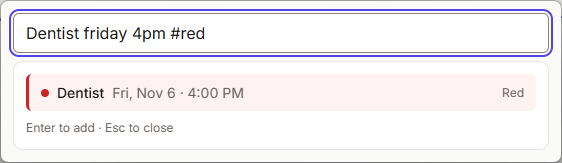 | 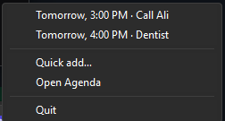 | 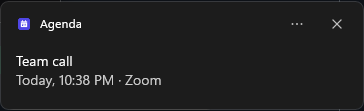 |

| Server not running                                                     |
| ---------------------------------------------------------------------- |
| 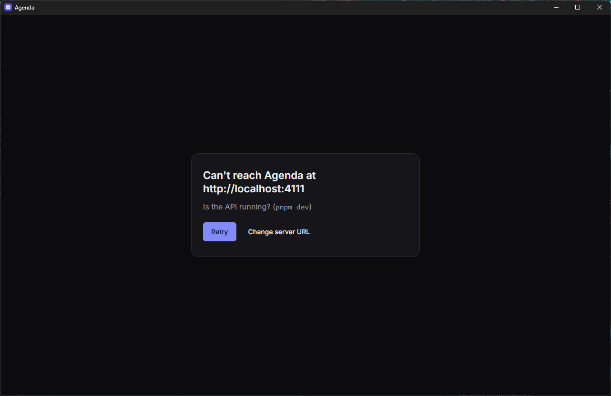 |

### Chrome extension

| Popup                                                    | Popup with the badge (dark)                                                 | Side panel                                                          |
| -------------------------------------------------------- | --------------------------------------------------------------------------- | ------------------------------------------------------------------- |
| 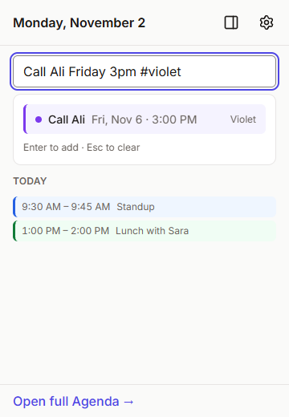 | 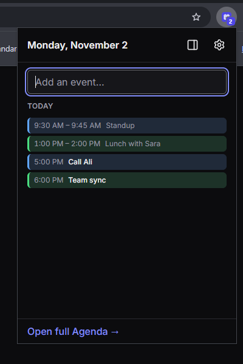 | 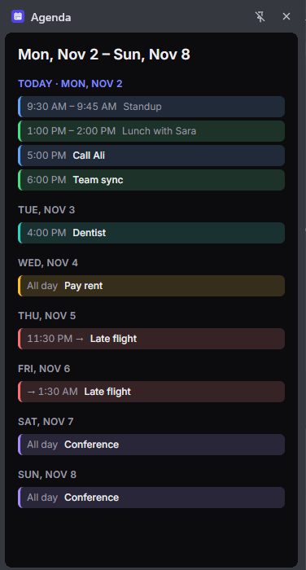 |

| Add to Agenda (right-click)                                               | Confirm before saving                                     | Server not running                                                |
| ------------------------------------------------------------------------- | --------------------------------------------------------- | ----------------------------------------------------------------- |
| 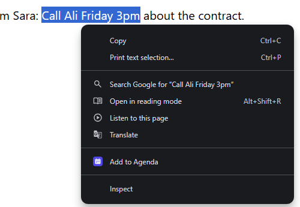 | 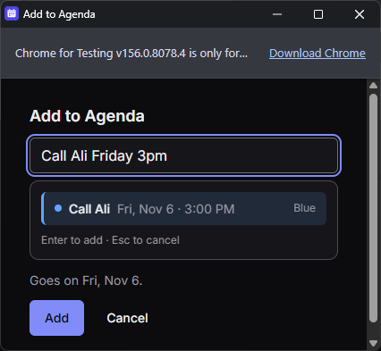 | 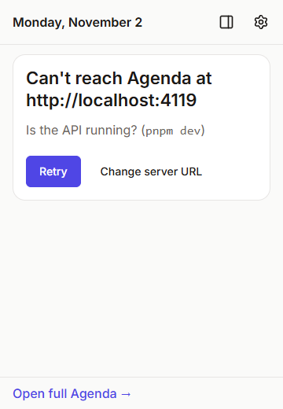 |

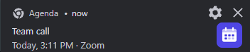

## Workspace layout

```
apps/
  api/        Hono API: events, auth (cookie or token), settings, import/export
  web/        Vite + React app (PWA); also the desktop app's UI
  desktop/    Tauri 2 desktop app: the Rust core around apps/web (see apps/desktop/README.md)
  extension/  Chrome extension (WXT, MV3): popup, side panel, Add to Agenda (see apps/extension/README.md)
  mobile/     Android app (Expo, Expo Router): tabs, bottom-sheet editor, reminders (see apps/mobile/README.md)
  e2e/        Playwright smoke test against the built api + web
packages/
  core/       Shared types, validation, dates, layout, quick add and the API client
  tokens/     Design tokens (color, spacing, type) for every platform
  ui/         Shared React components for web-based apps
  config/     Shared tsconfig, ESLint, Prettier and Vitest settings
```

Apps depend on packages through `workspace:*` links, so a change in `packages/core` is picked up by `apps/web` without publishing anything. Library packages compile to `dist/` with type declarations.

## Requirements

- Node.js 22.12 or newer (`.nvmrc` pins 24)
- pnpm, through Corepack: run `corepack enable` once (from an administrator terminal on Windows). The exact pnpm version (12.x) comes from `packageManager` in `package.json`.
- Git checks files out with LF line endings on every OS (`.gitattributes`), so Prettier gives the same result everywhere.

## Getting started

The first time, give the API a password (it refuses to start without one):

```sh
pnpm i
cp apps/api/.env.example apps/api/.env
pnpm -s --filter @agenda/api hash-password >> apps/api/.env   # asks for the password twice
```

Then:

```sh
pnpm dev
```

`pnpm dev` builds the shared packages, then starts the API (http://localhost:4001) and the web app (http://localhost:5173) in watch mode. Open the web app and log in. In dev, Vite forwards `/api` to the API, so both are on one origin and the session cookie works without CORS. To run a single app:

```sh
pnpm dev --filter @agenda/web   # Vite dev server on http://localhost:5173
pnpm dev --filter @agenda/api   # API in watch mode (tsx)
```

The service worker only runs in a build. To try the installable app locally, run `pnpm build`, start the API, then `pnpm --filter @agenda/web preview` (http://localhost:4173), and use Chrome's "Install app".

## Scripts

All scripts run through [Turborepo](https://turborepo.com), which orders tasks by package dependencies and caches results.

| Command          | What it does                                                     |
| ---------------- | ---------------------------------------------------------------- |
| `pnpm dev`       | Start the API and web app in watch mode                          |
| `pnpm build`     | Build every package and app (`dist/`)                            |
| `pnpm lint`      | ESLint across the workspace                                      |
| `pnpm typecheck` | `tsc --noEmit` in every package                                  |
| `pnpm test`      | Vitest in every package, Jest in mobile (with coverage gates)    |
| `pnpm e2e`       | Playwright smoke test on the built apps (run `pnpm build` first) |
| `pnpm format`    | Format the repo with Prettier (`format:check` to verify)         |

Add `--filter @agenda/<name>` (for example `--filter @agenda/core`) to any of them to limit the run to one package and its dependencies. `pnpm --filter @agenda/web icons` regenerates the app icons from `apps/web/public/icon.svg`. For the desktop app (Rust required), see [apps/desktop/README.md](apps/desktop/README.md): `pnpm --filter @agenda/desktop dev` and `pnpm desktop:installer`.

## Continuous integration

Every pull request and push to `master` runs `.github/workflows/ci.yml`. One job installs with a frozen lockfile, then runs `format:check`, `lint`, `typecheck`, `test` and `build`. The first also zips the Chrome extension and keeps it as an artifact. A second job builds the apps and runs the Playwright smoke tests in Chromium, the extension loaded in one of them. A third, on Windows, runs `cargo fmt`, `clippy` and the Rust tests for the desktop app, then builds its installer and keeps it as a downloadable artifact. Run the same checks locally before opening a PR.

## The original app

The v0 app (Create React App and Express) is no longer in the tree. The last commit before the rebuild is tagged `legacy-agenda`; check it out to see or run the old code. Its exports still import: Settings > Data takes an old `AgendaData.json`.
